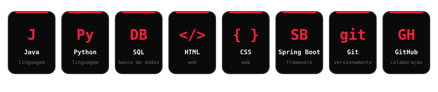

<!--
  README de perfil — Bruna Matos
  Este arquivo deve ficar na raiz do repositório PÚBLICO brunamatos2307-debug/brunamatos2307-debug
  As imagens usam a branch "main". Veja GUIA.md para o passo a passo.
-->

 

## 🖤 sobre_mim.md

Olá! Sou **Bruna Matos**, estudante de Tecnologia da Informação e desenvolvedora em formação.

Gosto de transformar ideias em soluções por meio da programação. Tenho interesse em **desenvolvimento de software**, **desenvolvimento web**, **banco de dados** e **tecnologia aplicada a problemas reais**.

Estou sempre aprendendo, desenvolvendo projetos e explorando novas possibilidades.

## 📟 terminal.exe

## ⚙️ tecnologias.json

## 📊 planilha_demo.xlsx

> Uma planilha decorativa: os números são só para enfeitar, não são estatísticas reais.

## 🚀 projetos/

<table>
  <tr>
    <td width="50%" valign="top">
      <h3>👾 ALIENVAC</h3>
      
Jogo educativo desenvolvido para ajudar crianças a compreenderem a importância da vacinação de maneira lúdica.

      

        
        
      

      

    </td>
    <td width="50%" valign="top">
      <h3>💇🏾‍♀️ SISTEMA PARA TRANCISTA</h3>
      
Sistema desenvolvido em Java para ajudar uma profissional trancista a organizar seu negócio, com gerenciamento e agendamentos.

      

        
        
        
      

      

    </td>
  </tr>
  <tr>
    <td width="50%" valign="top">
      <h3>🗄️ BANCO DE DADOS</h3>
      
Experiência com desenvolvimento e utilização de banco de dados em projetos acadêmicos.

      

        
        
      

      <!-- Quando publicar o repositório, troque o badge abaixo por:
      

 -->
      

    </td>
    <td width="50%" valign="top">
      <h3>🌐 PROJETO WEB</h3>
      
Atualmente desenvolvendo um projeto com HTML e CSS.

      

        
        
        
      

      <!-- Quando publicar o repositório, troque o badge abaixo pelo link, igual ao exemplo do Banco de Dados. -->
      

    </td>
  </tr>
</table>

## 📈 estatisticas.log

> As estatísticas são geradas automaticamente a partir da sua conta, então começam pequenas e crescem com você.

## 📬 contato.sh

<!-- E-MAIL (quando quiser): tire os símbolos de comentário da linha abaixo e troque SEU_EMAIL.

-->

 

